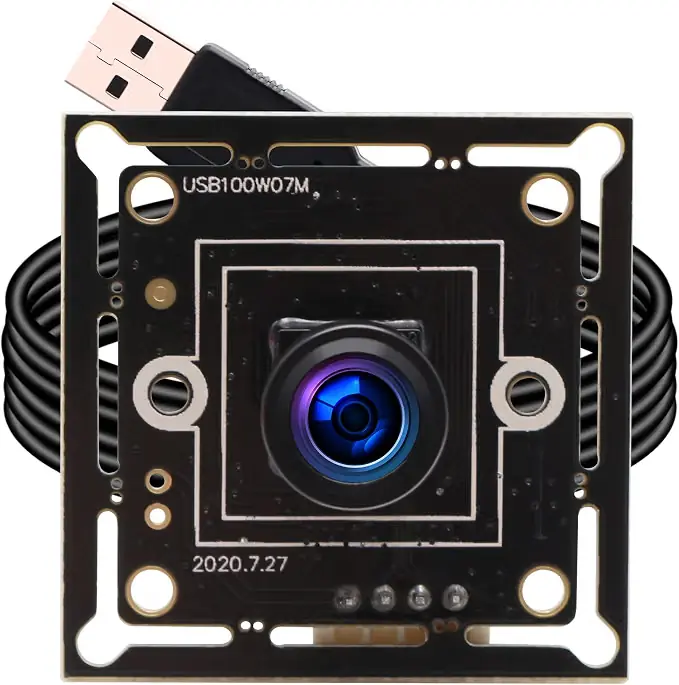
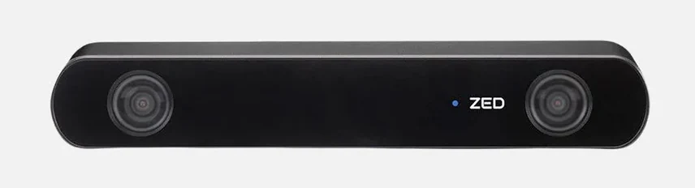
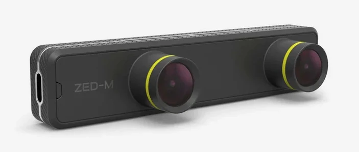

# Cameras

Our rover is capable of supporting up to 15 concurrent camera streams. To achieve this we utilize multiple different cameras along with a Startech 4-Port PCIE card with 4 independent USB 3.2 controllers. We use the following cameras on the rover:

## USB 2.0 Cameras
For the 2025-2026 competition year our team used mostly USB 2.0 cameras. These cameras provided us with a cheap and simple option for capturing multiple camera streams. Up to three USB 2.0 cameras can be placed on a single USB sontroller. For the most part, the Startech PCIE card ports are populated by these USB 2.0 cameras.



## StereoLabs ZED Camera
Our team uses a single ZED stereo camera. The ZED is used for object detection and point cloud creation during the autonomous mission. The ZED populates one of the USB-C ports of the Jetson.



## StereoLabs ZED Mini Camera
Our team also uses a single ZED Mini stereo camera. The ZED Mini is mounted to our team's mast gimbal and serves as a rotatable camera for missions, as well as taking a panorama during the science mission. The ZED Mini populates one of the USB-C ports of the Jetson.



## Adding a camera
To add a camera first check the existing UDEV rules and make sure that a device is defined for the port that you want to add the camera to. For instance, if you want to add a USB camera to the first slot of the splitter on port A, ensure that port_a1_cam exists in the UDEV rules. You can check if the UDEV rule is working as expected by looking for the device in /dev when the camera is connected to the desired port.

Next, add a new camera to config/cameras.yaml. Ensure that the new camera uses the correct device name and a unique port. For USB 2.0 cameras set the dimensons to 640x480 and the framerate to 15fps to ensure that three cameras can fit within bandwidth limits. If the camera that you are adding is the ZED or ZED Mini instead provide the desired image topic. After updating the camera config update the corresponding client config. For instance if you added a camera to the arm update config/arm_client.yaml.

Finally, launch correct camera client launch file for desired camera setup. For instance if you want to use the arm setup launch jetson_arm.launch.py.

## V4L2
```sh
sudo apt install v4l-tools
```

## GStreamer
[installation](https://gstreamer.freedesktop.org/documentation/installing/index.html?gi-language=c)

## Camera commands
```sh
v4l2-ctl --list-devices
# example output
HD USB Camera: HD USB Camera (usb-0000:00:14.0-6):
        /dev/video2
        /dev/video3
        /dev/media1
```
```sh
v4l2-ctl -d /dev/video2 --<list-formats | list-formats-ext>
# example output for --list-formats
ioctl: VIDIOC_ENUM_FMT
        Type: Video Capture

        [0]: 'YUYV' (YUYV 4:2:2)
        [1]: 'MJPG' (Motion-JPEG, compressed)
```
```sh
# command to create a simple video sink from a jpeg usb cam
gst-launch-1.0 v4l2src device=/dev/video2 ! jpegedc | videoconvert | autovideosink
```
```sh
v4l2-ctl -d/dev/video2 --list-ctrls
#example output
User Controls

                     brightness 0x00980900 (int)    : min=-64 max=64 step=1 default=0 value=0
                       contrast 0x00980901 (int)    : min=0 max=95 step=1 default=32 value=32
                     saturation 0x00980902 (int)    : min=0 max=128 step=1 default=55 value=55
                            hue 0x00980903 (int)    : min=-192 max=128 step=1 default=0 value=0
        white_balance_automatic 0x0098090c (bool)   : default=1 value=1
                          gamma 0x00980910 (int)    : min=100 max=300 step=1 default=100 value=100
                           gain 0x00980913 (int)    : min=0 max=100 step=1 default=0 value=0
           power_line_frequency 0x00980918 (menu)   : min=0 max=2 default=1 value=1 (50 Hz)
      white_balance_temperature 0x0098091a (int)    : min=2800 max=6500 step=1 default=4600 value=4600 flags=inactive
                      sharpness 0x0098091b (int)    : min=1 max=7 step=1 default=2 value=2
         backlight_compensation 0x0098091c (int)    : min=0 max=3 step=1 default=1 value=1

Camera Controls

                  auto_exposure 0x009a0901 (menu)   : min=0 max=3 default=3 value=3 (Aperture Priority Mode)
         exposure_time_absolute 0x009a0902 (int)    : min=1 max=5000 step=1 default=179 value=179 flags=inactive
     exposure_dynamic_framerate 0x009a0903 (bool)   : default=0 value=1
```

### Code Info
Important camera GStreamer code exists in MRover ROS-2 repo. Specially:
```sh
/ros2_ws/src/mrover/esw/gst_camera_server # primary
/ros2_ws/src/mrover/esw/gst_websocket_streamer # potentially old and unused
```

## Camera Parameter Implementation
### Testing
```sh
ros2 topic echo /camera_controls --qos-durability transient_local --qos-reliability reliable
```
```sh
ros2 service call /test_cam_set_controls mrover/srv/SetCameraControls \
  "{values: [{name: brightness, value: 10}]}"
```